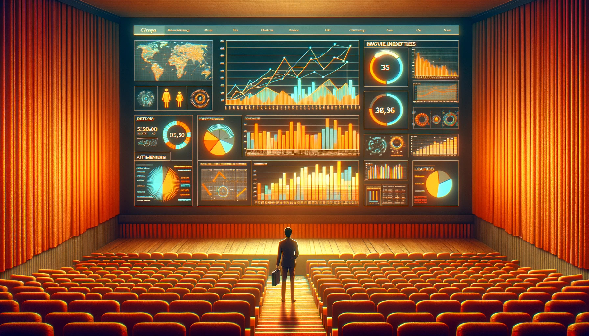
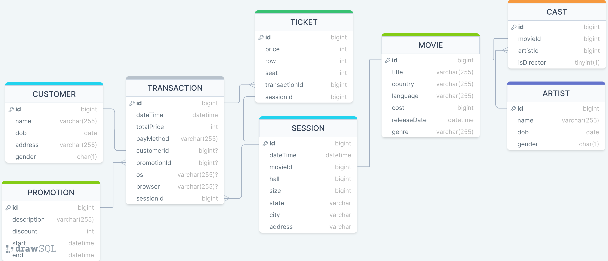

# CineDataQuest

Course project (course and term not stated in the repo; commits are from April 2024). A cinema ticketing database designed as a ROLAP schema in SQLite, populated with synthetic data, and queried with 18 SQL analysis questions.



## What it shows

- Schema design: a ticket-transaction fact table with customer, session, movie, cast, artist, and promotion tables (diagram below; DDL in `sqls/init1.sql`).
- Synthetic data generation with pandas into SQLite (`createDB.ipynb`).
- 18 analytical SQL queries with timing, run from `implementation.ipynb`; results are saved as CSV in `sql_result/`.

## How to run

```
pip install pandas jupyter
jupyter notebook createDB.ipynb      # builds esj2.db from sqls/init1.sql and toyData/
jupyter notebook implementation.ipynb  # runs the queries against esj2.db
```

`esj2.db` is not committed (it is git-ignored). Dependencies other than pandas/sqlite3 are not pinned; I did not re-run the notebooks when tidying this repo.

## Conceptual Design

### ROLAP Schema



### Assumptions

- The central focus of the data model is the "Transaction" entity, which serves as the primary event for creating a fact table. (Snowflake schema)
- Online transactions must have a non-null value for OS and browser.
- We assume that when customers conduct an offline transaction, they are buying tickets for sessions in the respective theater. Customers will not purchase tickets for sessions in Theater A while physically present at Theater B.
- Ticket prices are assumed to be integer values.
- Promotion discounts are assumed to be integer values.
- Gender in all tables is represented by a single character:
  - Male - M, Female - F, Unknown - U.
- Datetime values in all tables are assumed to be non-null.
- The database is assumed to be constructed with SQLite.

## Data Scale

Per the comments in `createDB.ipynb`, the generated database holds roughly 1M ticket transactions and about 3M tickets, plus smaller tables (80 promotions, 3,000 customers, 500 movies, 2,000 artists, 5,000 cast rows, 10K sessions). The data is synthetic.
